<div align="center">

# Exclusive

**A complete online-shop front end built with React, in English and Arabic (RTL).**

[](https://ecommerce-one-teal-22.vercel.app)
[](https://github.com/Ayaalmadhon2004/Ecommerce-/actions/workflows/ci.yml)


[Live demo](https://ecommerce-one-teal-22.vercel.app) · [Features](#what-you-can-do) · [Tour](#a-tour-of-the-app) · [Run it](#run-it-on-your-computer) · [Structure](#project-structure) · [Contributing](#contributing)

</div>


## What this is

Exclusive is a storefront based on the "Exclusive" e-commerce design. It has no server of its own. Products and the demo login come from the public [FakeStore API](https://fakestoreapi.com), and everything the visitor does (cart, wishlist, language, billing details) is kept in the browser with `localStorage`, so it is still there after a refresh.

It is a good project to read if you want to see how a normal shop is put together in React: shared state, routing, forms, a translated and mirrored layout, and animation, without any backend code in the way.

## What you can do

- Browse a home page with a hero banner, a flash sale slider with a countdown, categories, best sellers, a promo block and new arrivals.
- Open the shop and filter products by category.
- Search from the header and get matching products.
- Open a product page with a gallery, quantity picker, delivery check and related items, or use the quick view popup straight from any product card.
- Like products and review them on a wishlist page.
- Add products to a cart, change quantities, remove them, and apply a coupon.
- Check out with billing details and a payment choice.
- Sign up or log in.
- Switch the whole site between English and Arabic.
- Use it on a phone: the layout adapts down to small screens and the header turns into a menu.

## A tour of the app

### Home and flash sales

The flash sale section pulls products from the API, shows a discount badge, the old price and the rating, and scrolls sideways with the arrow buttons.


### Best sellers and quick view

Hovering a card reveals "Add To Cart". The eye icon opens a quick view popup so you can read the description and add the product without leaving the page.

<table>
<tr>
<td width="50%">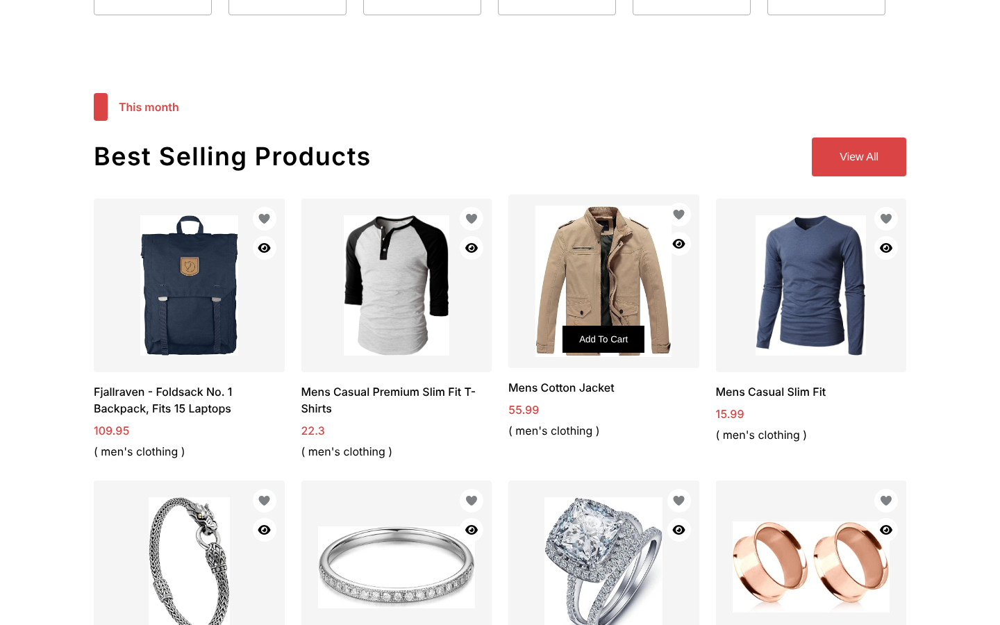<br><sub>Best selling products</sub></td>
<td width="50%">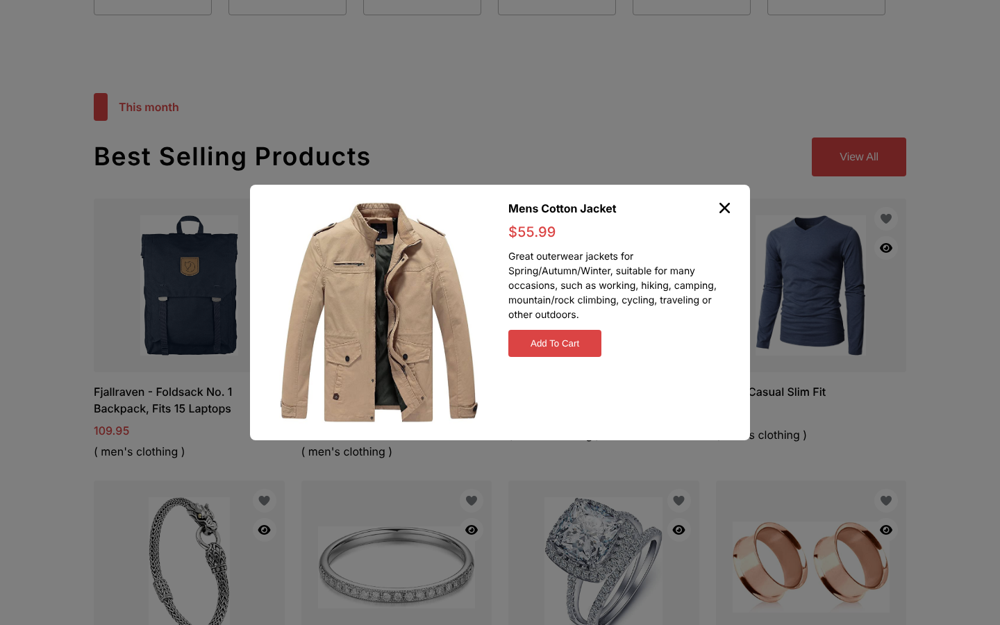<br><sub>Quick view</sub></td>
</tr>
</table>

### Categories and the promo block

<table>
<tr>
<td width="50%">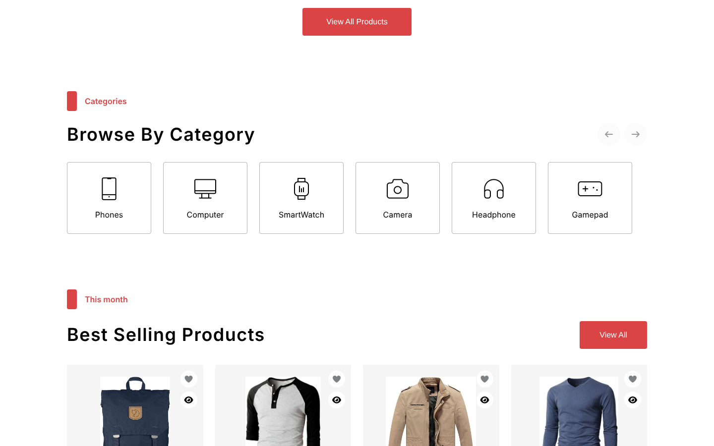<br><sub>Browse by category</sub></td>
<td width="50%">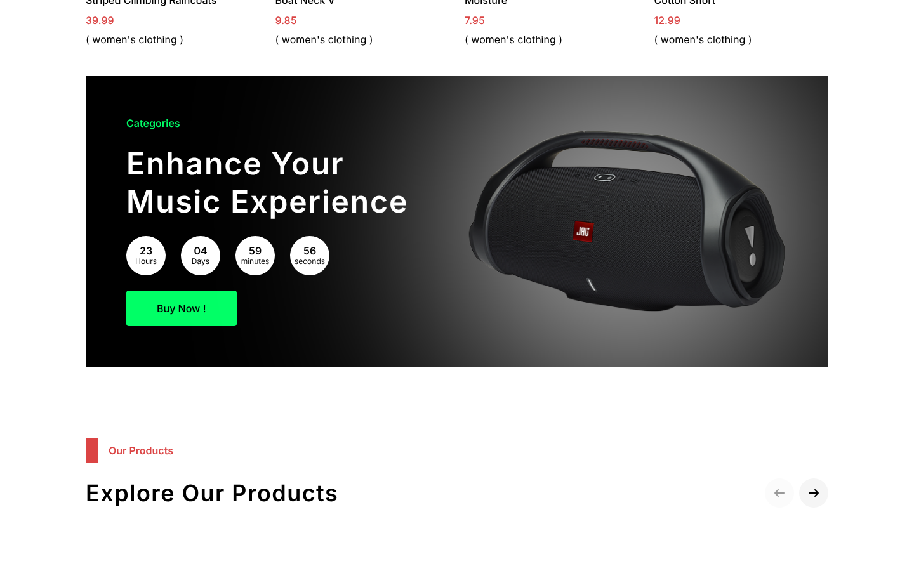<br><sub>Promo block with its own countdown</sub></td>
</tr>
</table>

### Shop and product page

The shop page has category filters, and the fashion and electronics links in the home page sidebar open it already filtered. The product page shows a gallery, rating, price, quantity picker, a postal code check and the return policy.

<table>
<tr>
<td width="50%">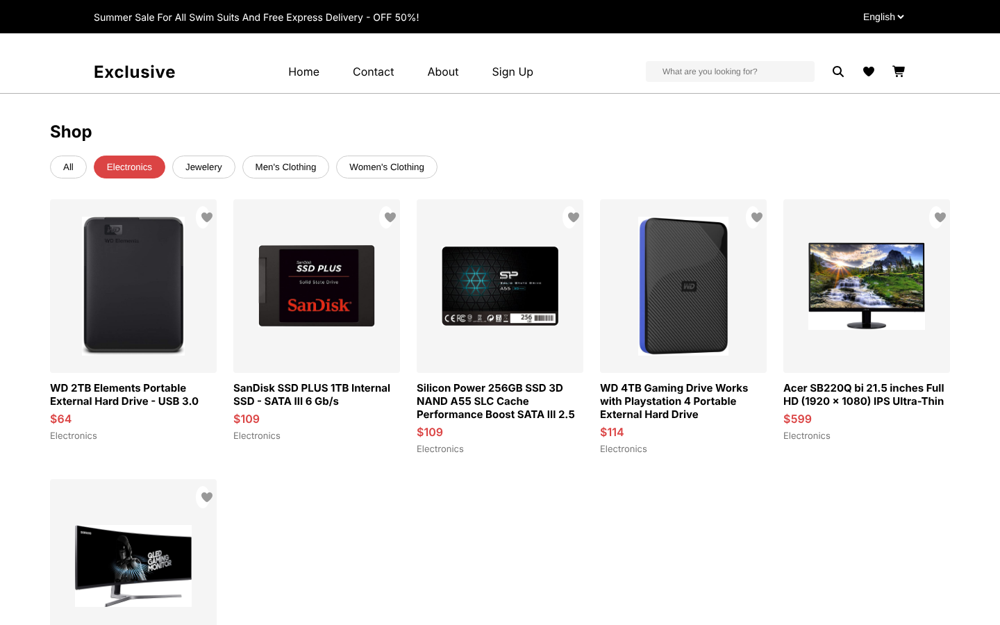<br><sub>Shop, filtered by category</sub></td>
<td width="50%">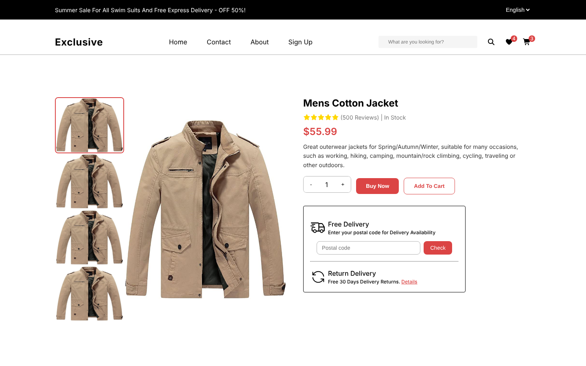<br><sub>Product page</sub></td>
</tr>
</table>

### Wishlist and checkout

The wishlist keeps everything you liked, grouped by the section it came from. Checkout shows the order, applies the coupon, and can remember your billing details for next time.

<table>
<tr>
<td width="50%">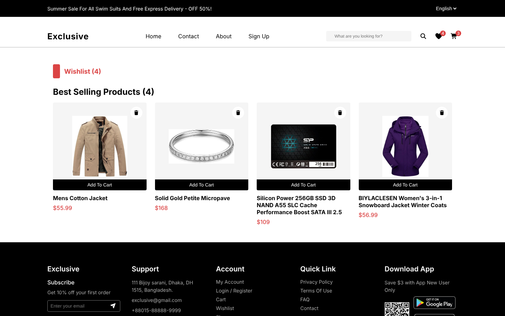<br><sub>Wishlist</sub></td>
<td width="50%">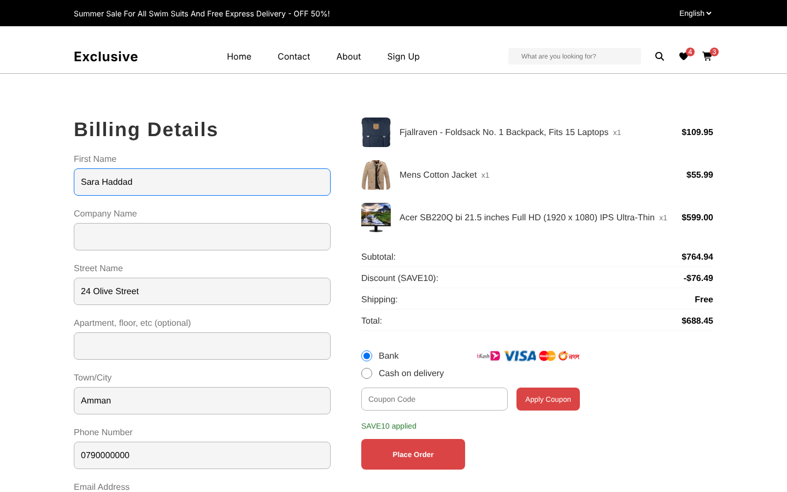<br><sub>Checkout with a coupon applied</sub></td>
</tr>
</table>

### Search and sign in

<table>
<tr>
<td width="50%">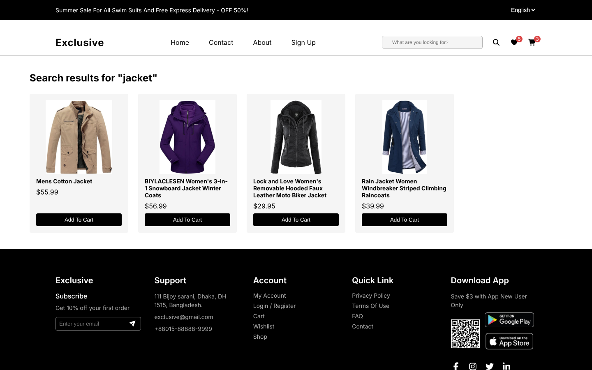<br><sub>Search results</sub></td>
<td width="50%"><br><sub>Log in (sign up is on the same page)</sub></td>
</tr>
</table>

### About and contact

<table>
<tr>
<td width="50%">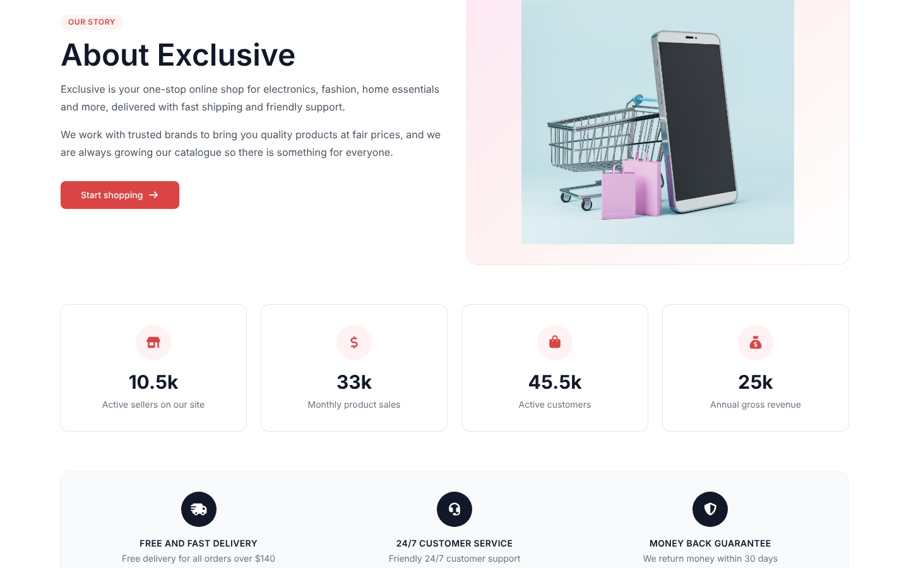<br><sub>About</sub></td>
<td width="50%">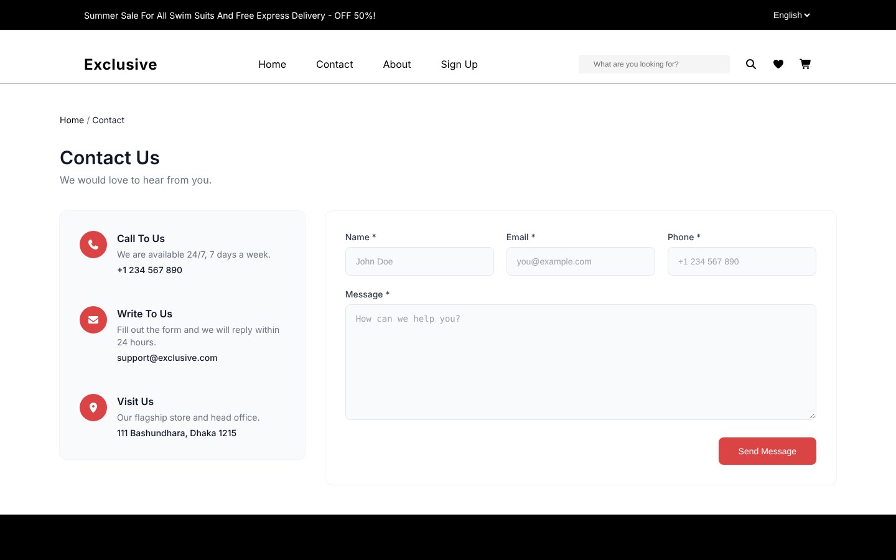<br><sub>Contact</sub></td>
</tr>
</table>

### Arabic and right-to-left

The language selector in the top bar changes the interface text and mirrors the layout. Your choice is saved, and English is used for any text that has no Arabic translation yet.

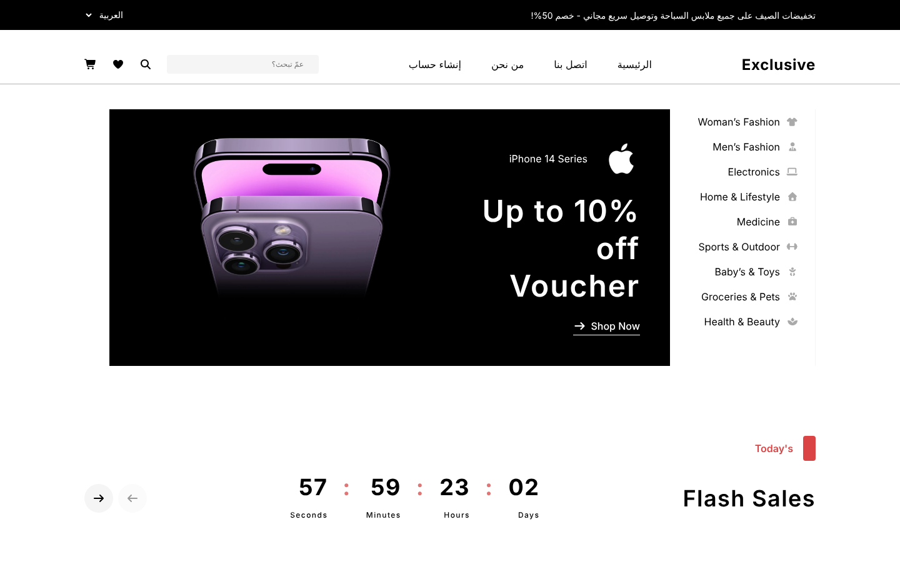

### On a phone

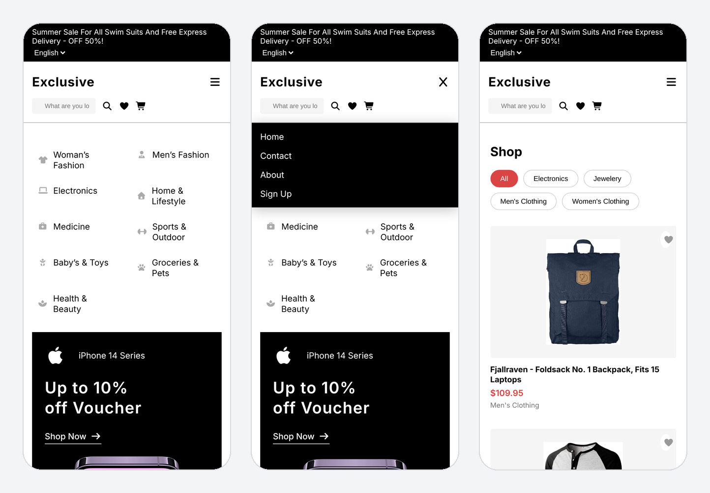

## Details worth knowing

**Cart and coupon.** Quantities go from 1 to 20. The coupon code `SAVE10` takes 10% off. The cart, the wishlist and the cart counter in the header all read from one shared context, so they never disagree.

**Checkout.** The form validates required fields and offers bank or cash on delivery. If you tick "Save this information", your billing details are filled in next time. There is no payment: placing an order only shows a confirmation.

**Accounts.** Signing up creates an account that lives in your browser only. You can also log in with the FakeStore demo account (username `mor_2314`, password `83r5^_`). "Forget Password?" only shows a confirmation, because there is no email service behind it.

**Countdowns.** The flash sale and promo countdowns are visual. They start from the same length every time the page loads.

**Animation.** Pages fade between routes, sections reveal as you scroll, cards lift on hover, cart totals count up and down, and a thin progress bar and a back-to-top button follow your scroll. Everything uses Framer Motion and respects the "reduce motion" setting of the operating system.

## Run it on your computer

You need Node.js 18 or newer.

```bash
git clone https://github.com/Ayaalmadhon2004/Ecommerce-.git
cd Ecommerce-
npm install
npm start
```

The app opens at http://localhost:3000. It needs an internet connection, because products, product images and the Font Awesome icons are loaded from the network.

Things to try first:

1. Open the shop, like a few products and add two or three to the cart.
2. Go to the cart and apply `SAVE10`.
3. Continue to checkout and place an order.
4. Switch the language to Arabic from the top bar.

| Command | What it does |
|---|---|
| `npm start` | Starts the development server |
| `npm run build` | Creates the production build in `build/` |
| `npm test -- --watchAll=false` | Runs the tests once |

## Built with

- React 19 and React Router 7
- Framer Motion for animation
- react-countdown for the flash sale timer
- CSS Modules for most components, and Tailwind CSS for the About and Contact pages
- Font Awesome icons, loaded from a CDN
- Create React App, Jest and Testing Library
- Deployed on Vercel

## Project structure

```
src/
├── App.js                 routes and the home page layout
├── context/               AppContext (cart, likes, coupon) and AuthContext
├── i18n/                  translations and the language provider
├── hooks/                 shared hooks, such as the sideways scroller
├── styles/                design tokens and shared CSS
└── components/
    ├── <Name>/            one folder per component: .jsx plus its own CSS Module
    ├── animations/        shared Framer Motion variants and helpers
    └── data/              static product, category and service data
```

State that survives a refresh is stored under these `localStorage` keys: `cart`, `likes`, `lang`, `token`, `username`, `localUsers` and `billingInfo`.

## Known limits

- Products, product images and the demo login depend on the FakeStore API. If it is down, the shop pages show an error and the flash sale section falls back to a small set of local products.
- Checkout, the contact form, the newsletter box and password reset have no backend. They confirm the action and nothing more.
- The Privacy Policy, Terms and FAQ pages contain placeholder text.
- `npm test` runs three smoke tests (rendering, cart logic and the wishlist flow). They pass, but coverage is small.

## Contributing

Branch names, commit style and the checks to run before pushing are in [`CONTRIBUTING.md`](CONTRIBUTING.md) (and [`CLAUDE.md`](CLAUDE.md)). In short: one change per branch, small commits, and `npm test` and `npm run build` must pass. CI runs both on every pull request.

## Author

Built by Aya Almadhon. [Portfolio](https://portfolio-of-aya.vercel.app) · [GitHub](https://github.com/Ayaalmadhon2004)
