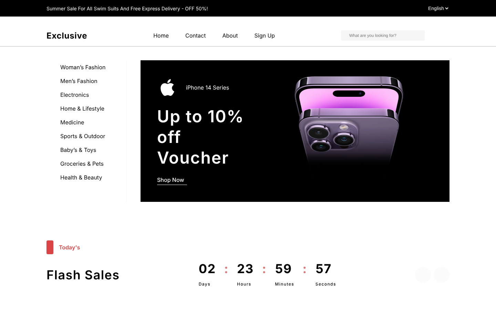
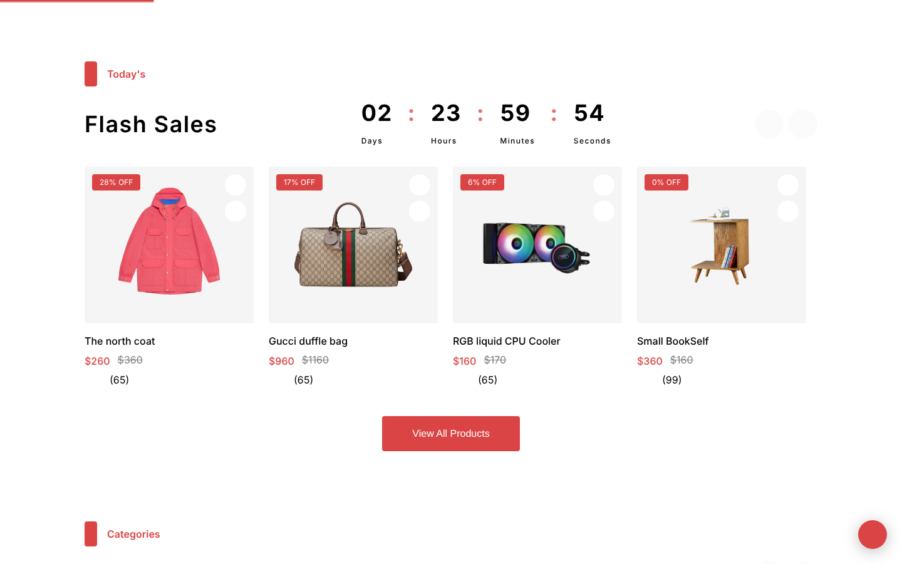
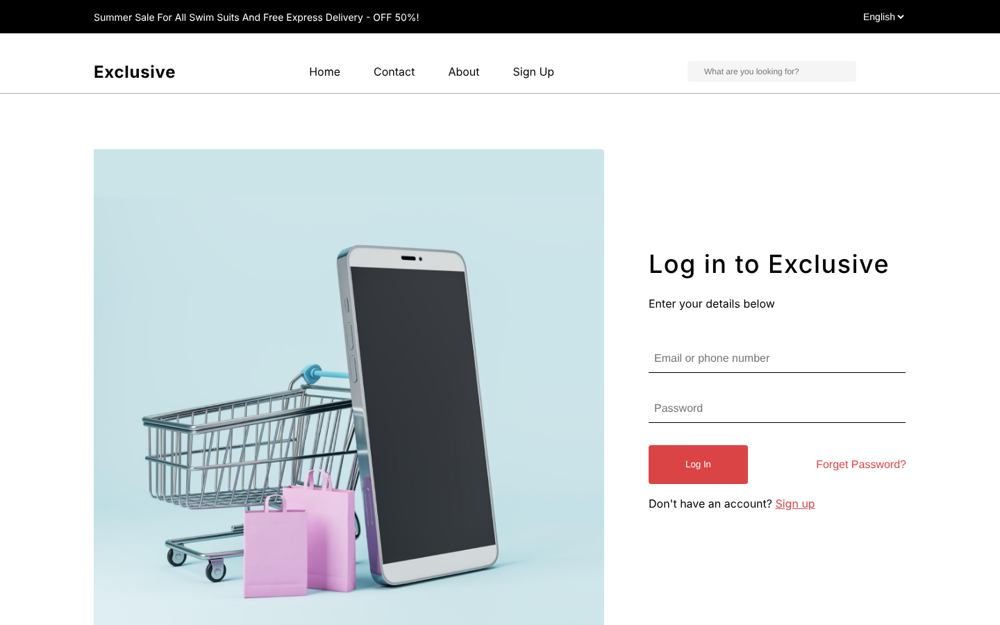

# Exclusive: E-commerce Storefront

**A responsive online shop built in React: product browsing, flash sales with a live countdown, wishlist, cart, checkout and Arabic / English with right-to-left layout.**

**Live demo:** [ecommerce-one-teal-22.vercel.app](https://ecommerce-one-teal-22.vercel.app)



## What it is

A front-end storefront based on the "Exclusive" design. It has no backend of its own: the cart and wishlist are kept in the browser (`localStorage`), and products and sign-in come from a public demo API. I built it to practise what every real shop needs: shared state, routing, forms, animation, and a layout that works from phone to desktop.

## Highlights



- **Flash sales.** A product slider with a live countdown, discount badges and "Add to cart". If the product API is down, the section falls back to local data instead of staying on "Loading..." forever.
- **Cart and wishlist.** Add, remove and change quantities, with totals and a coupon box. Everything goes through one `AppContext`, so every page stays in sync without prop drilling, and both survive a page refresh.
- **Shop, search and product details**, with category filters, a quick-view popup and a checkout page.
- **Login and sign up** with form feedback and error messages (see the notes below about the demo API).
- **Smooth animation** with Framer Motion: reveal on scroll, a flip-number countdown, an animated wishlist heart.
- **Arabic and English.** The language switch in the header also flips the page to right-to-left. English is the fallback for any missing key (`src/i18n`).
- **Tests** for the cart state and the wishlist flow.



## Tech stack

React 19 · React Router 7 · Framer Motion · react-countdown · CSS Modules · Create React App · Jest and Testing Library · deployed on Vercel.

## Run it locally

```bash
git clone https://github.com/Ayaalmadhon2004/Ecommerce-.git
cd Ecommerce-
npm install
npm start          # http://localhost:3000
```

| Command | What it does |
|---|---|
| `npm start` | Development server |
| `npm test` | Tests in watch mode (`npm test -- --watchAll=false` for a single run) |
| `npm run build` | Production build in `build/` |

## Project structure

```
src/
├── App.js                 routes and the home page composition
├── context/               AppContext (cart, likes) and AuthContext
├── i18n/                  translations and the language switcher
└── components/
    ├── <Name>/            one folder per component: .jsx + its own CSS Module
    └── data/              static product and category data
```

## Notes and known limits

- The shop, product details and login talk to the public [FakeStore API](https://fakestoreapi.com), so they need an internet connection and are only as available as that service. Its demo accounts are the only ones that can sign in.
- There is no payment. Checkout is a front-end flow only.
- Branch and commit rules for contributors are in [`CLAUDE.md`](CLAUDE.md).

## Author

Built by **Aya Almadhon**. [Portfolio](https://portfolio-of-aya.vercel.app) · [GitHub](https://github.com/Ayaalmadhon2004)
